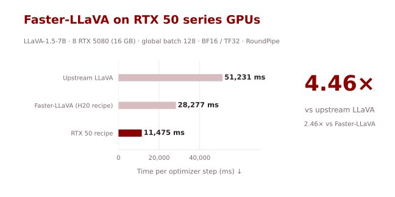
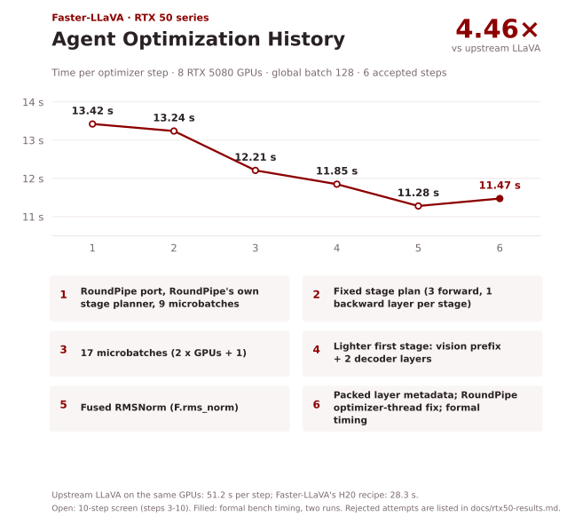

# Faster-LLaVA on RTX 50 series GPUs

[Faster-LLaVA README](README.md) · [RTX 50 results](docs/rtx50-results.md)

**4.46× faster LLaVA-1.5-7B training steps on 8×RTX 5080 (16 GB), optimized by AI agents.**



| Implementation on 8×RTX 5080 | Time / optimizer step (ms) ↓ | Speedup ↑ |
|---|---:|---:|
| Upstream LLaVA (ZeRO-3 + CPU AdamW offload) | 51,231 | 1.00× |
| Faster-LLaVA H20 recipe (ZeRO-3 + CPU AdamW offload) | 28,277 | 1.81× |
| **RTX 50 recipe (RoundPipe)** | **11,475** | **4.46×** |

Measured in a short benchmark on **8×RTX 5080**, global batch 128. For reference on other hardware, Faster-LLaVA takes 8,777 ms per step on 4×H20.

On 16 GB cards the DeepSpeed recipes need ZeRO-3 with CPU optimizer offload, and without GPU peer-to-peer every parameter gather crosses PCIe and host memory. The RTX 50 recipe instead trains in **one process with [RoundPipe](https://github.com/thustorage/RoundPipe)**: parameters, gradients and fp32 AdamW state live in host memory, and pipeline stages are streamed to the GPUs in turn. Peak GPU memory is 5.8 GiB.

## Quick Start

Prepare the [public data and model weights](docs/training.md#public-data-and-weights) as for the H20 recipe. Install the environment from [requirements-rtx50.txt](requirements-rtx50.txt) (PyTorch with CUDA 13 for sm_120, RoundPipe and the pinned LLaVA dependencies; these are the measured versions, and a fresh installation from the file has not been validated), then:

```bash
export LLAVA_ASSETS=/path/to/assets
export LLAVA_IMAGES=/path/to/images
export LLAVA_OUTPUT=/path/to/new-output/llava-v1.5-7b-rtx50
bash scripts/train_rtx50_7b.sh
```

The launcher uses every visible GPU and keeps the **global batch at 128**: each optimizer step holds `MICROBATCH × REFERENCE_GPUS × GRAD_ACCUM` = 16 × 8 × 1 samples, grouped as the 8-GPU DeepSpeed recipe groups them, whatever the number of local GPUs. The host needs about 180 GB of RAM for the 7B model's master weights, gradients and AdamW state. Checkpoints (every 1,000 steps) include the optimizer state, about 95 GB each; `RESUME=1` continues from the latest one. Keep "llava" in the output path: the upstream evaluation loader relies on it.

## Agent Optimization History

Measured on eight RTX 5080 GPUs at global batch 128, starting from a direct RoundPipe port.



## What changed

- **One process instead of ZeRO-3:** LLaVA as an `nn.Sequential` for RoundPipe, with packed microbatches (no padding) and the head computed only on supervised rows.
- **Pipeline shape:** a fixed stage plan with a light first stage and 2 × GPUs + 1 token-balanced microbatches.
- **Fewer kernel launches:** fused `F.rms_norm` and one metadata tensor per microbatch. RoundPipe launches the work of all GPUs from one Python process, so launch count matters more than kernel time; Liger's Triton kernels were slower here.
- **RoundPipe fixes:** the CPU optimizer thread could start with a single OpenMP thread when a pinned-memory data loader existed, and `import roundpipe` failed without a visible GPU.

See the [4-file change review](docs/change-views/rtx50-files.md) and the [RTX 50 configuration](scripts/configs/rtx50_7b.sh). These changes affect the numerical trajectory; they do not establish lossless acceleration.

## Full-training results

Pending: one epoch on all 665,298 instruction records (5,198 optimizer steps) on 8×RTX 5080, then GQA, TextVQA, POPE, ScienceQA-IMG and SEED-image under the upstream evaluation protocol, next to the official LLaVA-v1.5-7B checkpoint rerun under the same protocol.

See the [RTX 50 results, protocol and numerical checks](docs/rtx50-results.md).
